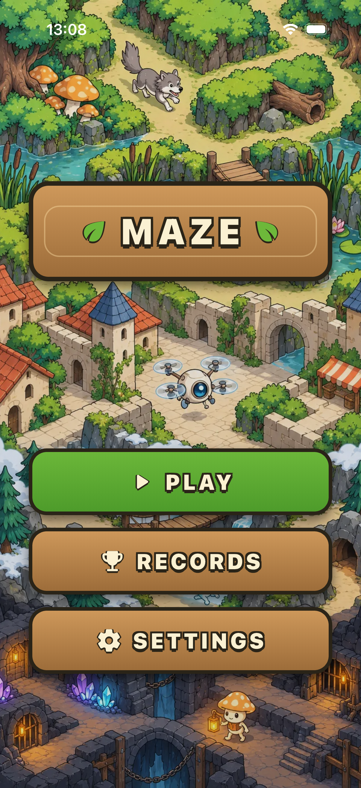
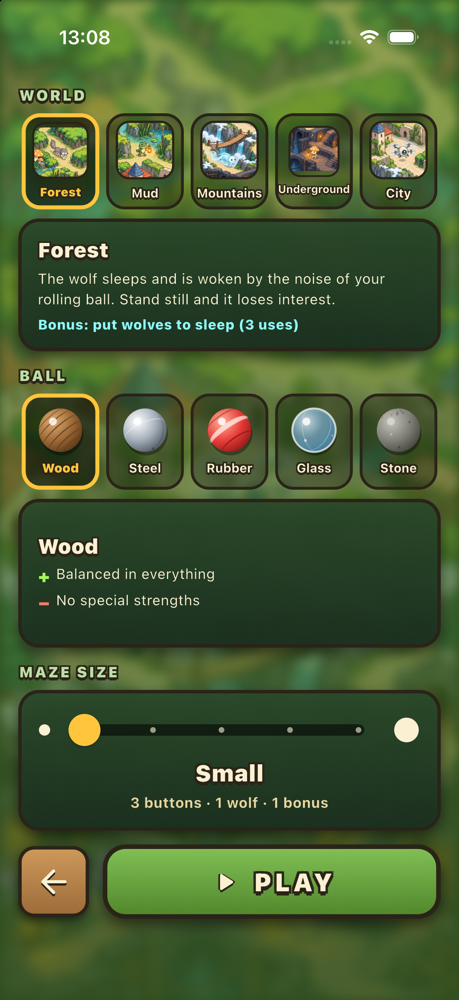
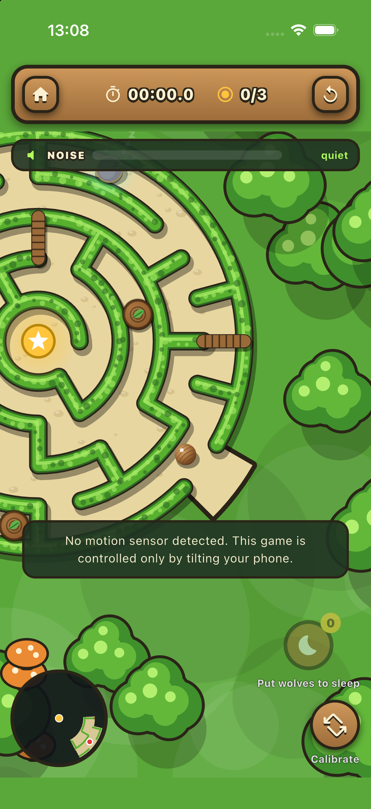
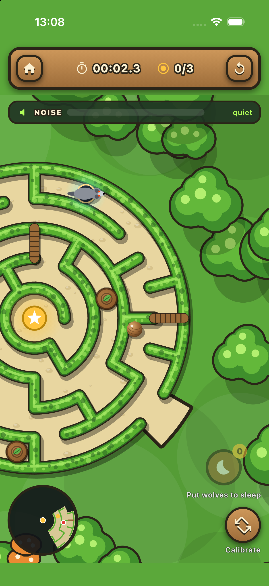
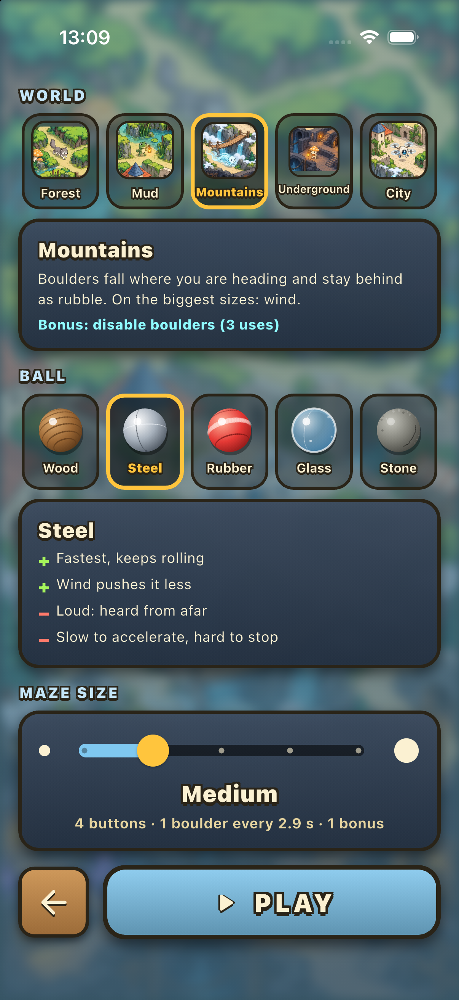
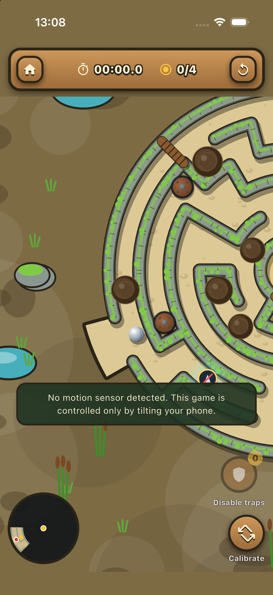
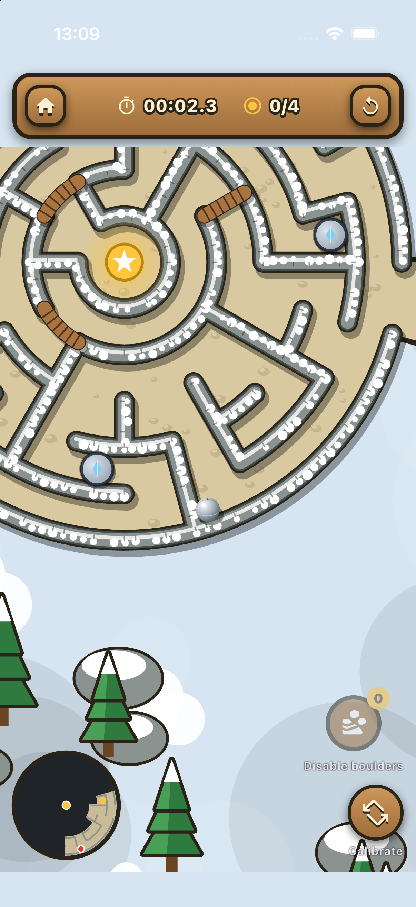
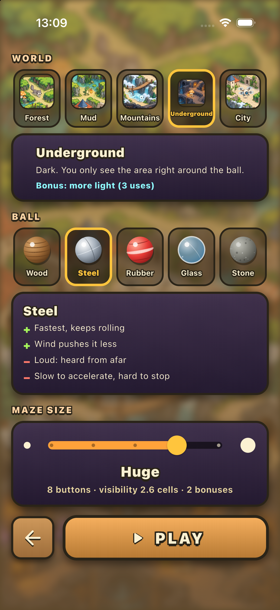
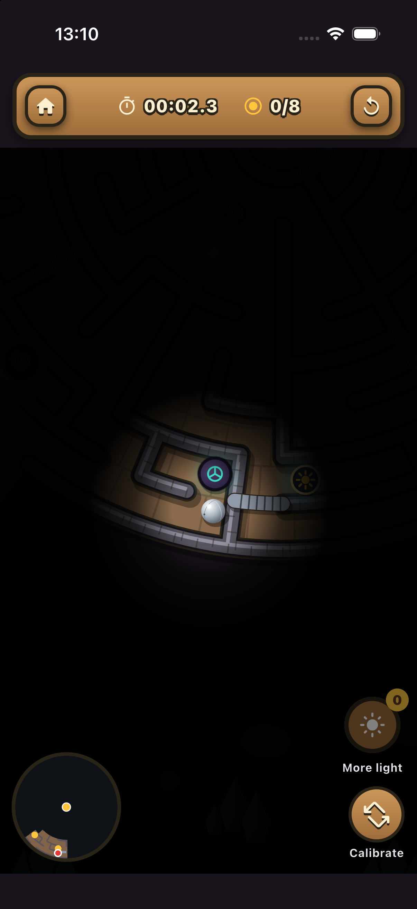
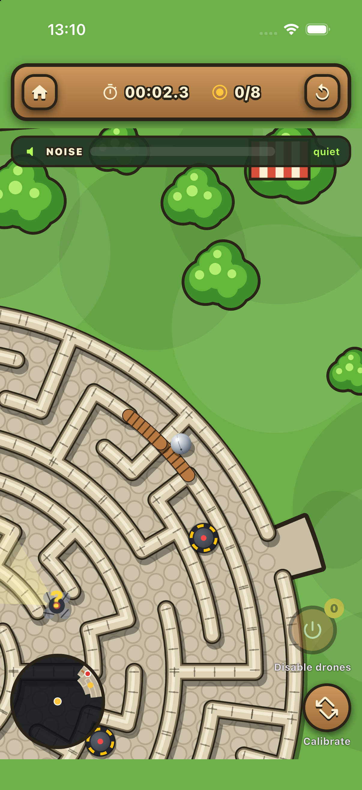

# Maze

A tilt-controlled ball maze game built with Flutter. Tilt your phone to roll the ball through a circular maze to the star in the centre — press all the buttons to open the gates, dodge the dangers of each world and beat your best time.

## Worlds

| World | Twist |
|-------|-------|
| 🌲 Forest | A sleeping wolf wakes up from the noise of your rolling ball. Stand still and it loses interest. |
| 🐸 Mud | Bogs pull you in and spikes pop up in the corridor ahead. |
| 🏔️ Mountains | Boulders fall where you are heading; on the biggest sizes, gusts of wind push the ball. |
| 🕳️ Underground | Pitch dark — you only see the area right around the ball. |
| 🏙️ City | Drones sleep until noise wakes them. If they spot you, you go back to the start. |

Each world has its own bonus (put wolves to sleep, disable traps / boulders / drones, more light), five ball materials (wood, steel, rubber, glass, stone — each with its own strengths) and five maze sizes from Small to Giant.

## Screenshots

| | | |
|---|---|---|
|  |  |  |
| Home screen | World, ball and maze size selection | Forest — the maze at the start |
|  |  |  |
| Forest — the wolf wakes up | Mountains setup with the steel ball | Mud — bogs and spike traps |
|  |  |  |
| Mountains — snowy maze with gates | Underground, Huge size | Underground — only the ball's light is visible |
|  | | |
| City — patrolling drones | | |

## Run

```bash
flutter pub get
flutter run
```

The game is controlled only by the accelerometer, so run it on a real device (or an emulator with simulated sensors).
